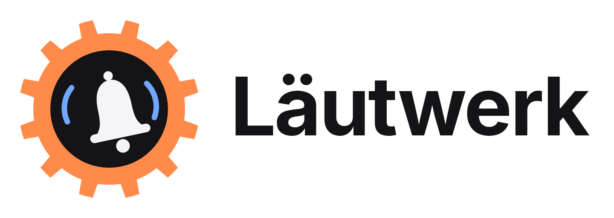

<p align="center">
  <picture>
    <source media="(prefers-color-scheme: dark)" srcset="docs/brand/readme-logo-dark.png">
    
  </picture>
</p>

# Läutwerk

Reminders for Home Assistant that turn **calendar events** into signals which
stay active **until someone acknowledges them**.

> **Status:** actively developed, current version **0.11.0**. All planned
> features from the spec are in: calendar, trigger and interval sources, keyword
> table with icons and colours, signals (push, light, announcement, own action),
> opportunities, quiet times, escalation, responsibility with substitute,
> templates. 1.0 follows after real-world testing; rules can also be created
> with the `laeutwerk.create_rule` action. See
> [docs/TASKS.md](docs/TASKS.md) for progress.

A *rule* describes an occasion: which calendar, which events (keyword table),
when to remind, which signals (push, light, announcement, any Home Assistant
action), when not to disturb and how "done" is recognised (push button, NFC
tag, door contact, zone, dashboard, service). Every matching event becomes a
*reminder* with its own state that stays open until it is acknowledged or
expires.

Läutwerk does not fetch events itself. Waste Collection Schedule, Google
Calendar, CalDAV or the local Home Assistant calendar remain the sources;
Läutwerk is the layer between "the event is in the calendar" and "somebody
has done it".

Läutwerk ships its own Lovelace card (`custom:laeutwerk-card`), which registers
itself – no manual resource needed. Sibling project:
[Zeitwerk](https://github.com/StiviDrum/zeitwerk).

## Installation (HACS, custom repository)

Requires Home Assistant 2026.11 or newer.

1. HACS → ⋮ → *Custom repositories* → `https://github.com/StiviDrum/laeutwerk`, type **Integration**.
2. Install **Läutwerk**, restart Home Assistant.
3. *Settings → Devices & services → Add integration → Läutwerk*.

## How it works

A reminder goes through these states: **planned** (event found) → **reminded**
(reminder time reached, signals sent) → **done** (acknowledged) or **missed**
(expired without acknowledgement). Signals are sent exactly once per reminder
time, also across restarts; a reminder time missed while Home Assistant was
off is caught up once.

Calendars are read with `calendar.get_events` (as many days ahead as
`lookahead_days` (default 14), every 15 minutes
and when a calendar changes).

### Example rule

*Developer tools → Actions → `laeutwerk.create_rule`*:

```yaml
action: laeutwerk.create_rule
data:
  config:
    id: muell
    name: Müll rausstellen
    sources: [calendar.abfallkalender]
    filter:
      all_day: true
      keywords:
        columns: [tonne]
        rows:
          - {match: Papier, tonne: Papiertonne, color: "#2f6bff"}
          - {match: Bio, tonne: Biotonne, color: "#43a047"}
    reminders:
      - at: "-1d 17:00"
    signals:
      - type: notify
        targets: [notify.mobile_app_my_phone]
        title: "{wann}: {tonnen}"
        message: "Bitte heute Abend rausstellen."
        actions:
          - {ack: true, label: "Steht draußen"}
    bundle: true
    expire: "event_day 12:00"
```

- **Keyword table:** an event matches when its title contains a keyword
  (`mode: contains`, default), starts with it (`startswith`) or matches a
  regular expression (`regex`). Without rows every event matches. Every column
  becomes a text variable. Each keyword can have its own `icon` and `color`
  (`{match: Bio, icon: "mdi:leaf", color: "#43a047"}`); the card shows the
  icon of the due keyword in its colour. Each part falls back to the rule's
  icon / colour on its own (icon only → rule colour, colour only → rule icon).
- **Headline:** `headline` sets how a
  reminder is titled in the card and the `headline` sensor attribute, e.g.
  `"{wann} raus: {tonnen}"`; default "{wann}: titles" ("Morgen: Papier + Bio").
- **Times** (`reminders[].at`, `expire`): `-1d 17:00` (the day before at
  17:00), `09:00` or `event_day 09:00` (on the event day), `-2h` / `-30m` /
  `-7d` (before the start), and for `expire` also `event_start` / `event_end`
  (default).
- **Bundling:** events of the same rule on the same day become one reminder;
  one acknowledgement finishes all of them.
- **Variables** in texts: `{titel}`, `{rest}` (title without the keyword),
  `{beschreibung}`, `{ort}`, `{kalender}`, `{wann}` (heute / morgen / am
  Donnerstag – English wording if Home Assistant is not set to German),
  `{datum}`, `{uhrzeit}`, plus one per column and its plural with an appended
  `n`: `{tonnen}` = "Papiertonne und Biotonne".
- **Waiting time and reminder number:** `{seit}` (time since the first
  reminder, e.g. "seit 25 Minuten" / "seit 1 Std. 25 Min." / "seit 1 Tag 3 Std.";
  in English "for 25 minutes"), `{seit_min}` (the minutes as a number),
  `{erinnert_um}` (time of the first reminder, HH:MM), `{nr}` (number of the
  reminder: 1 = first; counts repeats, escalation stages and reminders after
  "later"). They are evaluated at every send; a repeated push replaces the
  previous one, so the waiting time shown is current.
- **Plural per column:** where a plural makes no sense (e.g. `artikel`),
  switch it off in the column header of the card or write the column as
  `{name: artikel, plural: false}`. Then there is no `{artikeln}`, and with
  several matches `{artikel}` contains the different values joined with
  "und" ("die", or "die und den"). An own plural name:
  `{name: tonne, plural: tonnen_liste}`. Plain names keep the default plural.
- **Acknowledge:** the button in the push notification, the entity
  `button.laeutwerk_<rule>_erledigt`, the action `laeutwerk.acknowledge`, an
  NFC tag or any trigger (see below).
  Early acknowledgement depends on the rule's `early` setting (see *Done ahead of time*).

### Sources

Every rule has exactly one source:

- **Calendar:** `sources: [...]` – calendars, to-do lists with a due date, and
  date / datetime entities or date helpers. `lookahead_days` (per rule, default
  14) sets how far ahead events are read; it must cover the earliest reminder
  time, which Läutwerk checks when you save.
- **Trigger:** `start_triggers` – any Home Assistant trigger, written as in
  automations, starts a reminder immediately. While a reminder is open no second
  one starts – except with `expire: "never"`: then a new trigger marks the open
  reminder as missed and starts a fresh one. Trigger rules default to
  `expire: "+12h"`; `expire` also accepts `+<duration>` or `never`. The action `laeutwerk.start` starts one from an automation.
- **Interval:** `interval: {every: 90}` – due again 90 days after the last
  acknowledgement (see *Responsibility, escalation and more*).

Example "dryer" (all entity names and texts are placeholders – `input_select.trockner_status` stands for your own status helper; replace it with yours):

```yaml
id: trockner
name: Trockner fertig
start_triggers:
  - {trigger: state, entity_id: input_select.trockner_status, to: "Fertig"}
signals:
  - id: fertig
    type: notify
    audience: all
    send_on: first
    title: "Trockner ist fertig!"
    message: "Räum mich aus!"
    actions:
      - {ack: true, label: "Ausgeräumt"}
  - id: erinnerung
    type: notify
    audience: all
    send_on: repeat
    title: "Erinnerung: Trockner ausräumen"
    message: "Die Wäsche wartet {seit}."
    actions:
      - {ack: true, label: "Ausgeräumt"}
escalation:
  - {after: "1h"}
  - {after: "10:00", min_age: "8h"}
acknowledge:
  - type: trigger
    trigger: {trigger: state, entity_id: input_select.trockner_status, from: "Fertig"}
on_missed:
  - action: input_select.select_option
    target: {entity_id: input_select.trockner_status}
    data: {option: "Bereit"}
expire: "+32h"
```

### Signals

A rule can have any number of signals. Every signal has a type, optional
"only if" conditions, quiet times and, for opportunity signals, a frequency limit:

```yaml
signals:
  - id: push
    type: notify
    send_on: all                 # all | first | repeat | stage
    audience: persons            # all | present | persons | assignee
    persons: [person.steven, person.anna]   # their phones (companion app)
    only_present: true           # only those of them who are at home
    targets: [notify.alexa_media_kueche]    # older setting: further notify actions
    title: "{wann}: {tonnen}"
    message: "Bitte heute Abend rausstellen."
    actions:
      - {ack: true, label: "Steht draußen"}
  - id: lampe
    type: light_signal
    entity: light.stehleuchte
    send_on: first              # blinks once, at the first reminder
    pattern: {effect: blink, count: 3}    # blink | pulse, interval in seconds
    color_from_keyword: true     # blink in the colours of the matched keywords
    color: "#ff8800"             # else / otherwise a fixed colour
    restore: true                # previous state (on/off, brightness, colour) afterwards
    quiet:
      - {from: "00:00", to: "10:00", mode: skip}
  - id: ansage
    type: announce
    players: [media_player.sonos_wohnzimmer]
    volume: 45
    tts: tts.piper               # default: the first TTS entity
    text: "Stell endlich die {tonnen} raus!"
    quiet:
      - {from: "22:00", to: "08:00", mode: defer}   # send when the quiet time ends
    send_on: stage
    stage: 1                     # once, when escalation stage 1 is reached (e.g. 20:00)
  - id: eigene
    type: action
    conditions:
      - {condition: state, entity_id: input_boolean.urlaub, state: "off"}
    conditions_match: all        # all | any
    actions:
      - action: script.turn_on
        target: {entity_id: script.muell_szene}
        data:
          variables: {text: "{{ wann }}: {{ tonnen }}"}
```

**On opportunity.** Instead of `when: now` a signal can wait for any Home
Assistant trigger (state, zone, tag, event …) – it fires whenever the trigger
fires while the reminder is open:

```yaml
  - id: lampe
    type: light_signal
    entity: light.stehleuchte
    color_from_keyword: true
    when:
      opportunity: {trigger: state, entity_id: light.stehleuchte, to: "on"}
      manual_only: true          # wall switch / app / dashboard, not automations
    limit: {per_reminder: 1}
  - id: ansage
    type: announce
    players: [media_player.sonos_wohnzimmer]
    text: "{person}, stell bitte die {tonnen} raus!"
    when:
      opportunity: {trigger: state, entity_id: binary_sensor.haustuer, to: "on"}
    limit: {per_reminder: 1}     # front door: at most once per reminder
```

`{person}` is who came home or operated the device, as far as Home Assistant
knows it. The triggers are only listened to while a reminder is open.

- **Push recipients:** in the card you simply tick persons; Läutwerk sends to
  their phones. Only persons with the companion app are offered anywhere in
  Läutwerk. Push to explicitly ticked persons always goes to all of them;
  anyone may acknowledge. Optionally only to those who are at home, or to the
  responsible person. Notify actions are only needed for other devices.
- **Repeated pushes** of one reminder replace each other (same tag) and are
  removed when the reminder is done or missed.
- **Household quiet time:** set once in the integration options (*Settings →
  Devices & services → Läutwerk → Configure*): one window with *skip* or
  *defer*. Every signal without its own quiet time uses it.
- **Light:** every keyword can have its own colour (`color: "#2f6bff"` in
  its row, colour picker in step 2); with `color_from_keyword` the lamp
  blinks in the colours of the matched keywords (alternating when several
  match), else in the fixed colour. Colours are `#rrggbb`, `r,g,b` or German
  and English colour names. Lamps without colour just blink. A lamp that was
  off is switched off again.
- **Announcement:** played with `announce: true`, so players that support it
  lower running music and continue afterwards. `volume` is the announcement
  volume for players that support it (e.g. Sonos).
- **Custom action:** any Home Assistant actions; the text variables are
  available as template variables (`{{ tonnen }}`, `{{ reminder_id }}`).
- **Try it:** `laeutwerk.test_signal` sends one signal immediately (`rule` +
  `signal`, or `config` with an unsaved signal).

### Repeat, snooze and ways to acknowledge

Repeat is `once` or `repeat`: every N minutes (default 60) while the reminder
is open, at most M times (default 24).

```yaml
repeat: {every: 1h, max: 5}      # while open: remind again every hour, 5 times
acknowledge:
  - {type: tag, tag_id: tonne}   # NFC tag (before the reminder time: see `early`)
  - {type: tag, tag_id: "{nfc}"} # tag per bin from the keyword column "nfc"
  - type: trigger                # door contact, zone, button: any trigger
    trigger: {trigger: zone, entity_id: person.steven, zone: zone.kult61, event: enter}
signals:
  - type: notify
    audience: present
    message: "{wann}: {tonnen}"
    actions:
      - {ack: true, label: "Steht draußen"}
      - {snooze: 3h, label: "Später"}
```

**Tag per keyword:** with a column such as `nfc` (tag id per bin) and
`tag_id: "{nfc}"`, only the tag of the bin that is due acknowledges; for a
bundle (Rest + Bio on one day) each of its tags acknowledges the whole bundle.
Other tags do nothing. Fixed and variable tags can be mixed.

`laeutwerk.snooze` (or the push button) sets a reminder back to *planned*; it
reminds again when the time is over, unless it expires first.

### Done ahead of time

```yaml
early: {mode: hours, hours: 24}  # off | hours | always (default: hours, 24)
early_feedback: {message: "{titel} ist erst {wann} dran.", clear_after: 10}
```

- **`off`:** only from the reminder time on.
- **`hours`:** from `hours` hours before the first reminder time (default 24).
- **`always`:** at any time. The early acknowledgement then finishes the next
  planned reminder (for a tag: the next reminder of that tag; for interval
  rules the next interval counts from then).

The setting applies to every way of acknowledging: the push button, the card,
NFC tags, door contacts, zones, button triggers and `laeutwerk.acknowledge`.

**Too early:** `early_feedback` sends a short push with the next date to the
person who tried (otherwise the responsible person). It is removed again after
`clear_after` seconds (default 10). The card shows the same text as a short
message, and `laeutwerk.acknowledge` returns `too_early` with that text.

### Responsibility, escalation and more

```yaml
# Due again n days after it was last acknowledged (no calendar needed).
# In the card: step 1 → Source → Custom ("recurring after it was last done").
# Overdue reminders (also overdue to-dos) remind daily until done.
interval: {every: 90}            # or "12w"; optional start: 2026-12-01

# Only active under conditions and / or in a season (event day, MM-DD).
activation:
  match: all                     # all | any
  conditions:
    - {condition: state, entity_id: input_boolean.urlaub, state: "off"}
  season: {from: "04-01", to: "11-30"}

# Responsible person: {zustaendig} in texts, push audience "assignee",
# statistics in get_rules (status.assignee_stats).
assignee:
  persons: [person.steven, person.anna]
  rotation: per_event            # fixed | weekly | per_event | after_last
  substitute: person.alida       # placeholder: takes over ...
  substitute_when: {entity_id: input_boolean.vertretung, state: "on"}   # placeholder entity

# Escalation while open: stages start after a duration or at a time of day;
# a signal with `send_on: stage` and `stage: n` fires when stage n is reached.
escalation:
  - {after: 2h}
  - {after: "21:30", color: "#c58cff"}   # optional colour of the stage in the card

# Confirmation: a short push to whoever acknowledged (else the responsible
# person), removed again after clear_after seconds (default 10).
confirm: {message: "Danke, Müll ist raus!", clear_after: 10}

# Home Assistant actions when a reminder is acknowledged
# (variables: person, via, titel, tonne … as in texts, plus person_entity
# and zustaendig_entity).
on_done:
  - action: counter.increment
    target: {entity_id: counter.tonnen_rausgestellt}

# Hide the rule from the card overview (it stays listed under rules with an
# eye-off icon; signals and entities keep working).
visible: false
```

- **Send on (`send_on`):** when a signal is sent. `all` (default): every reminder – the first, every repeat, after "later" and every reached escalation stage. `first`: only the first reminder. `repeat`: from the second reminder on. `stage` with `stage: N`: exactly once, when escalation stage N is reached; add `stage_repeat: true` to send it again at every later reminder. Signals on opportunity only use `all` or `stage` (armed from stage N on). In the editor this is the field *Sent on* (German *Kommt bei*), section *When*.
- **Limit:** `limit: {per_reminder: N, min_interval: M}` – at most N times per reminder, M minutes apart. Only for signals on opportunity (e.g. a front-door announcement: at most once). Quiet times work for every signal.
- **Escalation times:** a stage `{after: "2h"}` counts from the first reminder;
  `{after: "10:00"}` (a clock time) means the next 10:00 after the first
  reminder. The optional `min_age: "8h"` skips the stage if it would come
  sooner than that after the first reminder. Example: dryer finished 19:42 →
  stage "10:00, min_age 8h" reminds the next morning; finished 06:30 → skipped.
- **Actions:** `on_done` runs when a reminder is acknowledged, `on_missed` once
  when a reminder is missed, `on_reminded` after every reminder (incl. repeats
  and stages). Variables include `rule_id`, `reminder_id`, `nr`, `seit_min` and
  the text variables. Errors are logged and block nothing.
- **Editor step 7:** has the separate blocks *When done · When missed · At every reminder*.
- **Substitute:** the substitute takes over when the entity given in
  `substitute_when` has the given state at reminder time. Läutwerk does not
  detect absence itself – you choose the entity (e.g. a vacation switch).
  `{zustaendig}`, the push audience "responsible person" and the statistics
  follow the substitute; the card shows e.g. "Alida (substitute for Steven)".
- **Rotation:** `fixed`, `weekly`, `per_event` or `after_last` (the person who
  acknowledged last).
- **Open reminders overall:** the entity `sensor.laeutwerk_offen` counts the
  reminders waiting for acknowledgement across all rules; its attribute
  `reminders` lists them (`rule_id`, `rule_name`, `headline`, `assignee_name`,
  `since`).

**Templates:** *+ Rule* in the rules section offers built-in templates (bins, birthdays,
maintenance, medication supply), your own templates (*Save as template* in
the editor) and *Import YAML*. `laeutwerk.export_rules` /
`laeutwerk.import_rules` (and *Export* in the editor) move rules as YAML.

### Entities (one device per rule)

| Entity | State |
|---|---|
| `sensor.laeutwerk_<rule>` | `planned` / `reminded` / `done` / `missed` / `inactive`, attributes with the event and its variables, plus `reminded_at`, `last_reminded_at`, `repeats`, `finished_at` |
| `sensor.laeutwerk_<rule>_wartet_seit` | timestamp of the first reminder while one is open, shown as "x minutes ago"; disabled by default – enable it in the entity settings |
| `sensor.laeutwerk_offen` | number of reminders waiting for acknowledgement over all rules (attribute `reminders`) |
| `binary_sensor.laeutwerk_<rule>_offen` | on while a reminder waits to be acknowledged |
| `sensor.laeutwerk_<rule>_naechster_termin` | start of the next matching event |
| `button.laeutwerk_<rule>_erledigt` | acknowledge |
| `switch.laeutwerk_<rule>` | rule on/off |

### Actions and events

`laeutwerk.acknowledge`, `snooze` (`duration` or `until`), `reopen`, `trigger`,
`test_signal`, `get_rules`,
`export_rules`, `import_rules`, `create_rule`, `update_rule`,
`delete_rule`, `duplicate_rule`, `enable`, `disable`. Editing actions need an
admin (calls from automations are allowed).

Events on the bus: `laeutwerk_reminded`, `laeutwerk_signal_sent`,
`laeutwerk_acknowledged`, `laeutwerk_missed` (data: `rule_id`, `reminder_id`,
`titles`, `variables`, …).

## Card

The card registers itself – add it to a dashboard via *Add card → Läutwerk*
or in YAML:

```yaml
type: custom:laeutwerk-card
view: overview        # overview | rule
rule: muell           # with view: rule
rules: [muell, kult61]   # optional filter for the overview
show_upcoming: true
show_done: true
compact: false        # one line: the next task; tap to confirm done, snooze or add a rule
```

- **Today & upcoming:** open reminders with *Later* (3 h) and the done button
  of the rule, upcoming reminders, today's finished ones ("done by Steven ·
  20:41 · NFC tag"), "All done" when nothing is open. Updates live.
- **Rule editor** (administrators, *+* or tap a rule): calendar, keyword table
  with free columns (scrolls sideways), live preview of the next matches,
  reminder times, repeat, signals, ways to acknowledge, bundling and expiry.
- **Compact** (`compact: true`): always the next task in one line (open ones
  first, the one that expires first on top, then planned ones) with the rule's
  icon and the number of open tasks. Tapping opens a dialog: confirm *done*
  (also ahead of time for planned tasks, if the rule allows it), *Later*, pick another task, reopen
  a task under *Done already*, or edit / create rules (administrators).
- **Confirmation:** marking a task as done and reopening one ask first – in
  the card and in the compact card's dialog.
- **Done ahead:** tasks done before their event stay visible under *Done*
  (card) / *Done already* (compact dialog) and can be undone until they
  expire.
- **Everyday use:** *Later* offers 1 hour, 3 hours or tomorrow morning;
  after *Done* a short message offers **Undo** (also `laeutwerk.reopen`).
  Tap a reminder for its details: when it reminded, what was sent, what comes
  next, who is responsible, which tags count. Rules can be sorted and, with
  many rules, searched.
- **Editor:** one step opens at a time, the others collapse with a one-line
  summary (new rules are filled in step by step); missing things are checked before saving and
  shown at their step in plain words; unsaved changes need a confirmation and
  are kept as a draft in the browser. Keywords are suggested from the event
  titles of the calendar; text fields suggest variables as you type `{`, the
  NFC tag field suggests the tags Home Assistant knows; signals can be tested
  before saving. Explanations sit behind small **?** icons (hover or tap).
  Features within a step are separated by thin lines.
- **Keyword table:** tap the round icon of a keyword to set its icon and
  colour or to delete it; the keyword column stays fixed while the variable
  columns scroll sideways.
- **One rule** (`view: rule`): the rule's reminders plus its history (last
  10 finished reminders: done by whom and how, or missed).
- **New rule:** the **+ Rule** button in the rules section creates a rule; the
  "+" in the card header is gone. Help bubbles (**?**) also work inside Home
  Assistant's dialogs.
- **Visual editor:** all options can be set in the dashboard's card editor.
- **Signal list:** each signal shows what it reaches ("Light · Stehleuchte",
  "Push · Steven, Anna"); signals of an escalation stage are marked in the
  stage's colour (set per stage in step 7). Lists have thin dividers.
- **Signal editor:** type, *immediately / on opportunity* with Home
  Assistant's trigger editor, *only if* with the condition editor, the fields
  of the type with variable suggestions and a text preview, limits and quiet times,
  *Test* and *Edit as YAML*. Every part is collapsible with a short summary;
  a push is split into recipients (tick persons), texts and buttons.
- **Colours** are picked with Läutwerk's own colour wheel (rule, keywords,
  escalation stages, light signal) with favourites, the rule's keyword colours
  and a hex field; the keyword colours can be tapped as the
  fixed colour of a light signal.

The card loads in parts: the overview needs 32.1 KB gzipped (98,295 bytes), the
editors (23.3 KB + 5.6 KB gzipped) and the visual card editor (1.7 KB gzipped)
load only when opened (measured with `gzip -9` on 0.10.0).

## Troubleshooting

- **Repairs:** a rule that refers to a calendar, light, speaker, person or
  notify action that does not exist (any more) gets a repair issue under
  *Settings → System → Repairs*. It disappears when everything is back.
- **Diagnostics:** *Settings → Devices & services → Läutwerk → ⋮ → Download
  diagnostics* (or on a rule's device page) contains the rules, their
  reminders and history – please attach it to bug reports.

## Development

Requires Python ≥ 3.14.2 and Node ≥ 20 (WSL2/Linux).

```bash
scripts/setup      # .venv + npm dependencies
scripts/develop    # local Home Assistant on http://localhost:8123 using ./config
scripts/lint       # ruff + eslint + prettier
scripts/test       # pytest + vitest
```

Card preview without Home Assistant (mocked data): `npm run build` in
`frontend/`, then `python3 -m http.server 8000` in the repo root and open
`http://localhost:8000/frontend/dev/preview.html` (`?page=editor`, `signal`,
`compact`, `rule`, `done`, `empty`; `?theme=light`, `?lang=en`, `?admin=0`).
`scripts/check_card.py` opens the card in the real frontend of the running dev
instance (headless Chromium) and takes screenshots.

The dev instance comes with two seeded local calendars ("Abfallkalender",
"Kult61") and helper stand-ins for presence, the front door and a lamp.

## License

MIT © Steven Glab

---

# Läutwerk (Deutsch)

Erinnerungen für Home Assistant: aus **Kalenderterminen** werden Signale, die
so lange aktiv bleiben, **bis jemand sie quittiert**.

> **Status:** in aktiver Entwicklung, aktuelle Version **0.11.0**. Alle geplanten
> Funktionen aus der Spezifikation sind drin: Quellen Kalender, Auslöser und
> Intervall, Stichwort-Tabelle mit Icons und Farben, Signale (Push, Licht,
> Ansage, eigene Aktion), Gelegenheiten, Ruhezeiten, Eskalation,
> Zuständigkeit mit Vertretung, Vorlagen. 1.0 folgt nach dem Praxistest; Regeln
> kannst du auch mit der Aktion `laeutwerk.create_rule` anlegen (Beispiel oben).
> Fortschritt siehe [docs/TASKS.md](docs/TASKS.md).

Eine *Regel* beschreibt einen Anlass: welcher Kalender, welche Termine
(Stichwort-Tabelle), wann erinnern, welche Signale (Push, Licht, Ansage,
beliebige Home-Assistant-Aktion), wann nicht stören und woran man „erledigt“
erkennt (Push-Knopf, NFC-Tag, Türkontakt, Zone, Dashboard, Dienst). Jeder
passende Termin wird zu einer *Erinnerung* mit eigenem Zustand, die offen
bleibt, bis sie quittiert wird oder verfällt.

Läutwerk holt keine Termine selbst – Waste Collection Schedule,
Google-Kalender, CalDAV oder der lokale HA-Kalender bleiben die Quellen.

## Quellen

Jede Regel hat genau eine Quelle:

- **Kalender:** `sources: [...]` – Kalender, To-do-Listen mit Fälligkeit sowie
  Datums- und Datum/Zeit-Entitäten oder Datums-Helfer. `lookahead_days` (je
  Regel, Standard 14) legt fest, wie weit voraus Termine gelesen werden; es muss
  den frühesten Erinnerungszeitpunkt abdecken – Läutwerk prüft das beim Speichern.
- **Auslöser:** `start_triggers` – jeder Home-Assistant-Auslöser, so geschrieben
  wie in Automationen, startet sofort eine Erinnerung. Solange eine Erinnerung
  offen ist, startet keine zweite – außer mit `expire: "never"`: dann markiert ein neuer
  Auslöser die offene Erinnerung als verpasst und startet eine frische. Auslöser-Regeln
  verwenden standardmäßig `expire: "+12h"`; `expire` akzeptiert auch `+<Dauer>` oder
  `never`. Die Aktion
  `laeutwerk.start` startet eine Erinnerung aus einer Automation.
- **Intervall:** `interval: {every: 90}` – fällig 90 Tage nach der letzten
  Quittierung (siehe *Zuständigkeit, Eskalation und mehr*).

Beispiel „Trockner“ (alle Entitätsnamen und Texte sind Platzhalter – `input_select.trockner_status`
ist ein Platzhalter für deinen eigenen Status-Helfer; ersetze ihn durch deinen):

```yaml
id: trockner
name: Trockner fertig
start_triggers:
  - {trigger: state, entity_id: input_select.trockner_status, to: "Fertig"}
signals:
  - id: fertig
    type: notify
    audience: all
    send_on: first
    title: "Trockner ist fertig!"
    message: "Räum mich aus!"
    actions:
      - {ack: true, label: "Ausgeräumt"}
  - id: erinnerung
    type: notify
    audience: all
    send_on: repeat
    title: "Erinnerung: Trockner ausräumen"
    message: "Die Wäsche wartet {seit}."
    actions:
      - {ack: true, label: "Ausgeräumt"}
escalation:
  - {after: "1h"}
  - {after: "10:00", min_age: "8h"}
acknowledge:
  - type: trigger
    trigger: {trigger: state, entity_id: input_select.trockner_status, from: "Fertig"}
on_missed:
  - action: input_select.select_option
    target: {entity_id: input_select.trockner_status}
    data: {option: "Bereit"}
expire: "+32h"
```

## Variablen und Mehrzahl

Jede Spalte der Stichwort-Tabelle wird eine Textvariable, z. B. `{tonne}`.
Bei mehreren Treffern entsteht automatisch die Mehrzahl mit angehängtem `n`:
`{tonnen}` = „Papiertonne und Biotonne“. Wo das keinen Sinn ergibt (z. B. bei
`artikel`), schaltest du die Mehrzahl im Spaltenkopf der Karte aus oder
schreibst die Spalte als `{name: artikel, plural: false}`. Dann gibt es kein
`{artikeln}`, und `{artikel}` enthält bei mehreren Treffern die verschiedenen
Werte, mit „und“ verbunden („die“ bzw. „die und den“). Ein eigener Name für
die Mehrzahl: `{name: tonne, plural: tonnen_liste}`.

Zeit- und Nummern-Variablen: `{seit}` (Zeit seit der ersten Erinnerung, z. B.
„seit 25 Minuten“, „seit 1 Std. 25 Min.“ oder „seit 1 Tag 3 Std.“), `{seit_min}`
(die Minuten als Zahl), `{erinnert_um}` (Uhrzeit der ersten Erinnerung, HH:MM) und
`{nr}` (Nummer der Erinnerung: 1 = erste; zählt Wiederholungen, Eskalationsstufen
und Erinnerungen nach „Später“). Sie werden bei jedem Senden neu berechnet; ein
wiederholter Push ersetzt den vorherigen, die angezeigte Wartezeit ist also aktuell.

## NFC-Tag je Tonne

Mit einer Spalte wie `nfc` (Tag-ID je Tonne) und `tag_id: "{nfc}"` quittiert
nur der Tag der Tonne, die gerade fällig ist – im Editor unter „Erledigt
durch“ `{` tippen und die Variable aus den Vorschlägen wählen. Bei einem Bündel (Rest + Bio am selben Tag)
quittiert jeder der beiden Tags die ganze Erinnerung, andere Tags nichts.
Feste und variable Tags lassen sich mischen.

## Vorzeitig erledigen

```yaml
early: {mode: hours, hours: 24}  # off | hours | always (Standard: hours, 24)
early_feedback: {message: "{titel} ist erst {wann} dran.", clear_after: 10}
```

- **Nein** (`off`): erst ab dem Erinnerungszeitpunkt.
- **Vorher** (`hours`): ab so vielen Stunden vor dem ersten Erinnerungszeitpunkt
  (`hours`, Standard 24).
- **Jederzeit** (`always`): zu jeder Zeit. Die vorzeitige Erledigung erledigt
  dann die nächste geplante Erinnerung (bei einem Tag: die nächste Erinnerung
  dieses Tags; bei Intervall-Regeln zählt das nächste Intervall ab dann).

Die Einstellung gilt für jeden Weg des Erledigens: den Push-Knopf, die Karte,
NFC-Tags, Türkontakte, Zonen, Taster-Auslöser und `laeutwerk.acknowledge`.

**Rückmeldung bei zu frühem Erledigen:** `early_feedback` schickt der Person,
die es versucht hat (sonst der zuständigen Person), eine kurze Push-Nachricht
mit dem nächsten Termin. Nach `clear_after` Sekunden (Standard 10) verschwindet
sie wieder. Die Karte zeigt denselben Text als kurze Meldung, und
`laeutwerk.acknowledge` liefert `too_early` mit diesem Text zurück.

## Bedienung

- **Kompakte Karte** (`compact: true`): immer die nächste Aufgabe in einer
  Zeile mit Symbol und Zahl der offenen. Antippen öffnet ein Fenster: mit
  Nachfrage als erledigt markieren (geplante auch schon vorab, wenn die Regel
  es erlaubt), „Später“,
  eine andere Aufgabe wählen, unter „Schon erledigt“ eine Aufgabe wieder
  öffnen oder Regeln bearbeiten und neu anlegen (Admins).
- **Rückfrage:** Erledigen und Wieder-Öffnen fragen vorher nach – in der Karte
  und im Fenster der kompakten Karte.
- **Vorab erledigte Aufgaben** bleiben sichtbar – in der Karte unter
  „Erledigt“ mit ↶, im kompakten Fenster unter „Schon erledigt“ – und lassen
  sich bis zu ihrem Verfall rückgängig machen.
- Der Erledigt-Knopf in der Karte ist nur noch ein ✓; die Beschriftung kommt
  aus dem Erledigt-Knopf des Push-Signals.
- **Später** bietet 1 Stunde, 3 Stunden oder „Morgen früh“ (07:00); nach
  **Erledigt** erscheint kurz **Rückgängig** (auch als Aktion `laeutwerk.reopen`).
- Eine Erinnerung **antippen** zeigt Details: wann erinnert, was gesendet
  wurde, was als Nächstes kommt, wer zuständig ist, welche Tags zählen.
- Im **Regel-Editor** öffnet sich immer nur ein Schritt, die anderen klappen mit
  Zusammenfassung zu; neue
  Regeln füllst du Schritt für Schritt („Weiter“). Fehlendes wird vor dem
  Speichern am jeweiligen Schritt angezeigt, ungespeicherte Änderungen
  brauchen eine Bestätigung und bleiben als Entwurf im Browser.
- **Signale** zeigen, wen oder was sie erreichen („Licht · Stehleuchte“,
  „Push · Steven, Anna“); Signale einer Eskalationsstufe sind in deren Farbe
  markiert – die Farben legst du in Schritt 7 je Stufe fest. Listen haben
  feine Trennlinien.
- **Stichwörter** werden aus den Termintiteln des Kalenders vorgeschlagen.
  Textfelder schlagen beim Tippen von `{` die Variablen vor, das NFC-Feld die
  in Home Assistant bekannten Tags. Signale lassen sich schon vor dem
  Speichern **testen**. Erklärungen liegen hinter kleinen **?** (Mouseover
  oder Antippen).
- **Icon und Farbe je Stichwort:** in der Stichwort-Tabelle den runden Kreis
  antippen – dort auch „Stichwort löschen“. Die Karte zeigt das Icon des
  fälligen Stichworts in seiner Farbe; fehlt eines von beiden, gilt das Icon
  bzw. die Farbe der Regel.
- **Überschrift** (Schritt 6 „Feinheiten“): wie eine Erinnerung heißt, z. B.
  `{wann} raus: {tonnen}`; ohne Angabe
  „Morgen: Papier + Bio“. Auch als Attribut `headline` am Regel-Sensor.
- **Neue Regel:** der Knopf **+ Rule** im Regel-Bereich legt eine Regel an; das „+“
  im Karten-Kopf entfällt. Hilfe-Bubbles (**?**) funktionieren auch in Dialogen von
  Home Assistant.
- **Regeln sortieren** (↑/↓) und bei vielen Regeln **durchsuchen**.
- **Quelle** in Schritt 1: *Kalender*, *Auslöser* oder *Intervall* – Intervall
  ist wiederkehrend nach dem letzten Erledigen (z. B. Filter alle 90 Tage),
  ohne Kalender.
- **Wiederholen:** *einmal* oder *wiederholen* – alle N Minuten (Standard 60),
  solange die Erinnerung offen ist, höchstens M-mal (Standard 24).
- **Farben** wählst du mit Läutwerks eigenem Farbkreis (mit Favoriten, den
  Stichwort-Farben der Regel und Hex-Feld) – für die Regel,
  jedes **Stichwort** (Schritt 2) und jede Eskalationsstufe. Ein Licht-Signal
  blinkt in der **Farbe des Stichworts** (bei mehreren abwechselnd) oder in
  einer festen Farbe; die Stichwort-Farben lassen sich dort antippen.
- **Zuständigkeit und Vertretung:** `assignee: {persons, rotation, substitute,
  substitute_when}` – Rotation *fest*, *wöchentlich*, *pro Termin* oder *nach
  letztem*. Die Vertretung übernimmt, wenn die in `substitute_when` angegebene
  Entität zum Erinnerungszeitpunkt den angegebenen Zustand hat (Läutwerk erkennt
  Abwesenheit nicht selbst – du wählst die Entität, z. B. einen Urlaubsschalter).
  `{zustaendig}`, die Push-Zielgruppe „Zuständige“ und die Statistik folgen der
  Vertretung; die Karte zeigt z. B. „Alida (Vertretung für Steven)“. Angeboten
  werden überall nur Personen mit Companion-App.
- **Push-Empfänger:** Personen, die du ausdrücklich anhakst, bekommen die
  Nachricht immer alle; quittieren darf jeder. Wiederholte Pushes einer Erinnerung
  ersetzen einander (gleicher Tag) und verschwinden, wenn sie erledigt oder
  verpasst ist.
- **Ruhezeit im Haushalt:** einmal in den Integrationsoptionen (*Einstellungen →
  Geräte & Dienste → Läutwerk → Konfigurieren*): ein Zeitfenster mit *überspringen*
  oder *verschieben*. Jedes Signal ohne eigene Ruhezeit nutzt sie.
- **Bestätigung:** `confirm: {message, clear_after}` schickt eine kurze Nachricht
  an die Person, die quittiert hat (sonst an die Zuständige), und entfernt sie
  nach `clear_after` Sekunden (Standard 10). `on_done`-Aktionen bekommen zusätzlich
  die Variablen `person_entity` und `zustaendig_entity`.
- **Sendezeitpunkt (`send_on`):** wann ein Signal gesendet wird. `all` (Standard): jede Erinnerung – die erste, jede Wiederholung, nach „Später“ und jede erreichte Eskalationsstufe. `first`: nur die erste Erinnerung. `repeat`: ab der zweiten Erinnerung. `stage` mit `stage: N`: genau einmal, wenn Eskalationsstufe N erreicht wird; mit `stage_repeat: true` wird es bei jeder späteren Erinnerung erneut gesendet. Signale bei Gelegenheit nutzen nur `all` oder `stage` (scharf ab Stufe N). Im Editor heißt das Feld *Kommt bei* (Schritt *Wann*).
- **Grenze (`limit`):** `limit: {per_reminder: N, min_interval: M}` – höchstens N-mal pro Erinnerung, M Minuten auseinander. Nur für Signale bei Gelegenheit (z. B. Ansage an der Haustür: höchstens einmal). Ruhezeiten gelten für jedes Signal.
- **Eskalationszeiten:** eine Stufe `{after: "2h"}` zählt ab der ersten Erinnerung;
  `{after: "10:00"}` (eine Uhrzeit) meint die nächste 10:00 nach der ersten
  Erinnerung. Das optionale `min_age: "8h"` überspringt die Stufe, wenn sie
  früher als so lange nach der ersten Erinnerung käme. Beispiel: Trockner fertig
  um 19:42 → Stufe „10:00, min_age 8h“ erinnert am nächsten Morgen; fertig um
  06:30 → übersprungen.
- **Aktionen:** `on_done` läuft beim Erledigen, `on_missed` einmal, wenn eine
  Erinnerung verpasst wird, `on_reminded` nach jeder Erinnerung (inkl. Wiederholungen
  und Stufen). Variablen sind u. a. `rule_id`, `reminder_id`, `nr`, `seit_min` und
  die Textvariablen. Fehler werden protokolliert und blockieren nichts.
- **Editor, Schritt 7:** hat die getrennten Bereiche *Wenn erledigt · Wenn verpasst · Bei jeder Erinnerung*.
- **Ausblenden:** `visible: false` blendet eine Regel in der Kartenübersicht aus;
  sie bleibt unter den Regeln mit durchgestrichenem Auge sichtbar, Signale und
  Entitäten arbeiten weiter.
- **Sensor `sensor.laeutwerk_<regel>_wartet_seit`:** Zeitstempel der ersten
  Erinnerung, solange eine offen ist (Anzeige „vor x Minuten“); standardmäßig
  deaktiviert – in den Entitätseinstellungen aktivieren. Die Hauptsensoren haben
  zusätzlich `reminded_at`, `last_reminded_at`, `repeats` und `finished_at`.
- **Sensor `sensor.laeutwerk_offen`:** Anzahl der offenen Erinnerungen über alle
  Regeln; das Attribut `reminders` listet sie (`rule_id`, `rule_name`, `headline`,
  `assignee_name`, `since`).
- **Editor:** Erklärungen liegen hinter kleinen **?**-Symbolen, beim Tippen von `{`
  gibt es Vorschläge, Funktionen innerhalb eines Schritts sind durch feine
  Linien getrennt.
- **Karten-Größe:** Die Übersicht lädt 32,1 KB gzipped (98.295 Bytes); die
  Editoren (23,3 KB + 5,6 KB gzipped) und der visuelle Karten-Editor (1,7 KB
  gzipped) laden erst beim Öffnen (gemessen mit `gzip -9` auf 0.10.0).
- Der **Signal-Editor** ist in einklappbare Bereiche mit Zusammenfassung
  gegliedert; Push in Empfänger (Personen anhaken), Texte und Knöpfe.
  Notify-Aktionen gibst du nicht mehr an – alte werden der Person mit dem
  Handy zugeordnet.

## Installation (HACS, benutzerdefiniertes Repository)

Benötigt Home Assistant 2026.11 oder neuer.

1. HACS → ⋮ → *Benutzerdefinierte Repositories* → `https://github.com/StiviDrum/laeutwerk`, Typ **Integration**.
2. **Läutwerk** installieren, Home Assistant neu starten.
3. *Einstellungen → Geräte & Dienste → Integration hinzufügen → Läutwerk*.
